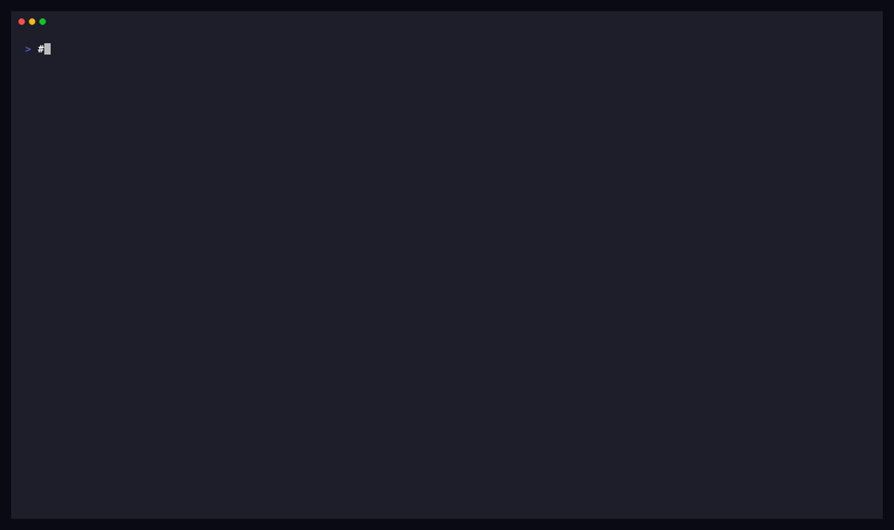

# pi-swival

Delegate tasks from Pi to [Swival](https://github.com/Swival/swival), with reviewer loops, configurable sandboxes, secret encryption, and request filtering.



The package bundles:

- `swival-subagent` extension: dispatches tasks to a swival subprocess with reviewer loops, sandboxes, and structured reporting. Mirrors the shape of pi's example subagent extension but swaps the spawn target to swival.
- `swival` skill: drives swival from any Pi agent via the extension, with reference material on AgentFS sandboxing and native provider setup.
- `auditing-with-swival` skill: one native audit on an isolated committed snapshot, with preserved state, reports, and patch proposals.
- `swival-worker-briefs` skill: task brief structure and evidence standards for `self-review-worker` dispatches.
- `swival-audit` prompt template: slash-command-style invocation that walks an interactive operator through the audit pipeline.
- Six swival agents: `swival`, `self-review-worker`, `test-runner`, `sandboxed-reviewer`, `sandboxed-explorer`, and `a2a-coordinator`.

## Install

```bash
pi install https://github.com/sheurich/pi-swival
```

Or pin a tag:

```bash
pi install git:github.com/sheurich/pi-swival@v1.0.0
```

Or install from a local checkout:

```bash
pi install /path/to/pi-swival
```

Pi installs runtime dependencies for managed git/npm packages. For a local checkout, install the pinned runtime dependency, `yaml` 2.9.0, from the checkout root with `npm install --ignore-scripts --legacy-peer-deps`.

The package registers `extensions/`, `skills/`, and `prompts/` automatically per its `package.json` `pi` manifest. The six bundled swival agents under `agents/` are discovered automatically by the extension at runtime: no symlinks or manual copies needed.

To override a bundled agent or add your own, place `.md` files in `~/.pi/agent/swival-agents/` (user scope) or `.pi/swival-agents/` in a project root (project scope). Discovery priority: project > user > bundled.

## Prerequisites

This package shells out to the `swival` CLI. Install it first:

```bash
uv tool install swival
# or: pipx install swival
```

The tested runtime is Swival 1.9.3 with LiteLLM 1.106.6 and Python >=3.13,<3.15. Operational tests use Python 3.13. Unpinned installation commands can select another release; native audits require the tested versions.

Swival routes models through `~/.config/swival/config.toml`. Its `bedrock` and `vertexai` providers reach AWS and Google Cloud natively, with no extra process to run. See `skills/swival/references/setup.md` for the full setup walkthrough.

## What's bundled

### Extension: `swival-subagent`

A Pi tool that dispatches single, parallel, or chained tasks, or one structured native audit. Ordinary delegation retains its existing report handling; native audit requires separate state and coverage evidence.

Key features beyond pi's example subagent extension:

- Reviewer loop (`selfReview` or test-as-contract `reviewer`) that retries until the reviewer accepts.
- Configurable sandboxes: AgentFS can permit host-base write-through; nono uses Landlock/Seatbelt. Use disposable directories for AgentFS write exploration.
- Network policy (`network: provider-only`, `network: none`).
- Format-preserving secret encryption (`encryptSecrets`).
- LLM request auditing (`extraArgs: ["--llm-filter", "..."]`).
- Standard input task delivery (protects prompts from `ps aux` and bypasses `ARG_MAX` when `sandbox: builtin` is configured).
- Operational telemetry (prompt cache token savings, security policy blocks, and storm breaker suppressions).
- Async / background runs in single mode, with saved `status` / `resume` results across sessions and same-process `interrupt`.

See `skills/swival/SKILL.md` for dispatch examples and `extensions/index.ts` for the full schema.

#### Agent catalogue

Call `swival-subagent` with `action: "list"` to inspect agent capabilities without launching Swival or probing a provider:

```json
{
  "action": "list",
  "cwd": "/path/to/project",
  "agentScope": "both"
}
```

`cwd` defaults to Pi's working directory. `agentScope` accepts `user` (the default), `project`, or `both`; bundled agents always remain available. Project discovery walks up from `cwd` to the nearest `.pi/swival-agents/` directory. List accepts only `action`, `cwd`, and `agentScope`. Dispatch and control fields, including `id`, `task`, overrides, and `async`, are rejected even when false or empty. List does not write files, prune artifacts, or ask for confirmation.

The result's `details` contains `mode: "list"`, `schemaVersion: 1`, the selected scope, and up to 20 sorted agent rows. Names appear verbatim; descriptions remain sanitized and limited to 160 UTF-16 code units, and model-facing text to 8192. `total` and `omitted` report exact agent counts. Rows expose descriptions, source scope, reviewer settings, configured sandbox/network settings, supported modes, and controls. They omit system prompts, command strings, provider routing, and definition paths.

Discovery deliberately restricts names so a listed selector matches dispatch exactly. Names must be nonblank, at most 80 UTF-16 code units, and unchanged by catalogue sanitation. Unicode names are supported; a surrogate pair counts as two code units. Leading or trailing whitespace, repeated spaces, tabs, control characters, ANSI escapes, and bidirectional formatting controls removed by sanitation make a name invalid. This is a compatibility restriction: previously accepted names that need sanitation or truncation now produce `invalid_definition`. Discovery never silently renames them. Update the definition's name and its callers to use an accepted selector.

`configured` contains sanitized declarations after scope restrictions. Missing settings appear as `"unknown"`; `effectiveRuntime` is always `"unknown"`. The catalogue does not read Swival's runtime configuration or prove effective sandbox, network, or reviewer behavior.

Discovery retains valid siblings and reports at most 12 fixed diagnostics with source scope. Codes are `invalid_yaml`, `invalid_frontmatter`, `invalid_definition`, `unreadable_definition`, `unreadable_directory`, and `outside_directory`. `diagnosticsTotal` and `diagnosticsOmitted` give exact counts without exposing parser messages or file contents.

Invalid admitted definitions fail closed. Discovery retains a nonblank invalid string name exactly, including any whitespace or control characters, for dispatch checks without exposing it in the catalogue. An identified invalid override blocks dispatch for that exact name instead of selecting a lower-priority definition. A valid higher-priority definition can repair an invalid lower-priority definition with the same accepted name. Empty or whitespace-only names, missing names, and nonstring names have unresolved identities and produce `invalid_definition`. An unresolved identity sets `dispatchBlocked: true` and blocks all dispatch before launch, including calls with an omitted or empty selector. Symlinks outside the scanned directory remain excluded and nonblocking; discovery does not read their targets.

`async: true` supports single dispatch only. It rejects `timeoutMs`, `output`, and `outputMode` before launch; use synchronous execution for those options. `status` reports progress or final results. `resume` retrieves completed output and reviewer feedback; it does not restart execution. `interrupt` can stop only a run tracked by the same Pi process. Live steering is unsupported.

Ordinary tasks use a fixed plain-text envelope. Leading `/` and `!` remain task text instead of invoking Swival command dispatch. Stored task metadata keeps the original text.

Ordinary `cwd` and `output` are caller-selected, not constrained to approved roots. Output writes occur in Pi outside the child sandbox. They provide no confidentiality guarantee. Synchronous output defaults to file-only metadata when `output` is set, except that failed chains inline nonempty partial output even in file-only mode. Parallel results require per-task output paths; top-level output does not bind them. Chain top-level output binds the last successful step, or the failing step on failure. Use unique paths to avoid overwriting results. `maxInlineBytes` counts characters, not bytes. See the [skill's output reference](skills/swival/SKILL.md#paths-and-output) for details.

Ordinary async runs write their report and default trace files into private system temporary storage. The host-side runner exports evidence before writing `completed.json`, without adding a sandbox write grant to the artifact directory. Export accepts only owned, single-link regular files: a report up to 16 MiB and traces of up to 4 MiB each, scanning at most 16 trace-directory entries (including rejected names), with a 64 MiB total limit. Rejected evidence produces value-free codes in `transfer-error.txt`; the worker exit code is preserved, and missing/invalid sandbox reports still fail bootstrap validation. Explicit trace destinations remain caller-owned and are not included in the default export. Default report/trace artifacts become available only after worker exit; forced-kill escalation can discard unexported evidence, and oversized traces are dropped rather than truncated.

The runner owns scratch storage after launch; the parent cleans it after confirmed runner termination if necessary. Abrupt Pi/runner SIGKILL can leave `pi-swival-async-*` temporary directories or incomplete `.tmp` artifact files for normal temporary-file hygiene. No background scavenger or completion-notification guarantee is added. If the runner cannot safely claim its directories or write a valid terminal marker, a run recovered from disk after a Pi restart reports `unknown` status (and `resume` returns an error) because process liveness is never probed. The offline integration gate checks host visibility using the actual `TMPDIR` directory family; macOS results do not establish Linux support.

### Optional async observation

Async launches save their owning session UUID even without an observation adapter. Without an adapter, pi-swival performs no observation scans, starts no observation timers, subscribes to no observation changes, and emits no observation wakes. Ownership and explicit `status`, `resume`, and same-process `interrupt` controls remain available.

Observation exposes only bounded state, never task text, output, or PIDs. Recovered runs without terminal evidence remain `unknown`, which does not prove live execution. The adapter omits them from Fleet and active waits. Legacy runs without an owner remain available through explicit `status` and `resume` queries. Native audit artifacts are excluded from async observation.

Observation preserves display-safe agent labels up to 160 UTF-16 code units. Admitted names containing Unicode formatting characters use the fixed observation label `Swival agent`; they still count as live work when a local handle proves execution. Catalogue selectors and execution metadata keep the exact original name. Observation labels never select agents for dispatch.

To include owned runs in pi-subagents Fleet and `bg_wait`, use the wrapper layout below. Install and review pi-subagents separately. Pi packages have separate module roots; installing both packages does not make their imports available to a user extension. pi-swival never discovers or installs the consumer.

Select the existing package directories explicitly. The synthetic paths `/opt/pi-packages/pi-swival` and `/opt/pi-packages/pi-subagents` below stand for your selected pi-swival checkout and pi-subagents package root. For Pi-managed installations, `pi list` shows the installed locations. Replace both targets with those locations; do not copy either package or install another dependency tree.

```bash
mkdir -p ~/.pi/agent/swival-observation/node_modules
ln -s /opt/pi-packages/pi-swival ~/.pi/agent/swival-observation/node_modules/pi-swival
ln -s /opt/pi-packages/pi-subagents ~/.pi/agent/swival-observation/node_modules/pi-subagents
```

Save this wrapper as `~/.pi/agent/swival-observation/index.ts`. Its imports resolve through the two wrapper-local links. Pi supplies the host API.

```typescript
import type { ExtensionAPI } from "@earendil-works/pi-coding-agent";
import registerSwival from "pi-swival/extensions/index.ts";
import { createPiSubagentsAdapter } from "pi-swival/integrations/pi-subagents.ts";
import {
  registerExternalRun, updateExternalRun, unregisterExternalRun,
} from "pi-subagents/external-runs";
import { registerBackgroundWorkProvider } from "pi-subagents/background-work";

export default function (pi: ExtensionAPI) {
  registerSwival(pi, {
    observationAdapter: createPiSubagentsAdapter({
      registerExternalRun, updateExternalRun, unregisterExternalRun,
      registerBackgroundWorkProvider,
    }),
  });
}
```

In `~/.pi/agent/settings.json`, disable the package's default extension and enable the wrapper:

```json
{
  "packages": [
    {
      "source": "https://github.com/sheurich/pi-swival",
      "extensions": []
    },
    "npm:pi-subagents"
  ],
  "extensions": ["./swival-observation/index.ts"]
}
```

Merge these entries into your existing settings. Replace the existing pi-swival entry with the object form, keeping its exact source and pin. Keep your existing pi-subagents source and other settings. Remove any separate entry that loads `pi-swival/extensions` directly, including project entries. The wrapper must be the only Swival extension entry point. Restart Pi or run `/reload`.

The adapter receives only the four public functions shown above. It uses the consumer's session file identity, with the UUID as its fallback. Cancelling `bg_wait` cancels the wait without stopping or otherwise controlling Swival execution. Observation emits only the private `pi-swival:async-observation` reconciliation event; it never starts a model turn. Use explicit `status` or `resume` to retrieve results.

The owner index retains live references and the newest 100 terminal references. Each observer projects at most 100 rows, prioritizing live runs; the adapter exposes at most 100 active wait items and 20 Fleet rows. With more than 100 live runs, selection is deterministic and live-only, with a truncation diagnostic. These display limits do not change execution. Selected runs deliver their validated terminal transition before removal, and overflow live work prevents a false idle snapshot.

Recovery is progressive. Each observer reads at most 256 directory entries and 4 MiB of aggregate artifact data per pass. Continuations finish a stable, finite directory over multiple passes while retaining validated partial rows. A one-shot observation read performs one bounded pass, not an exhaustive scan. The cache retains at most 100 validated rows with stat fingerprints, never raw reports.

The artifact root is absolute and fixed when the extension registers; new artifact paths are absolute too. Legacy relative paths are accepted only when their original resolution base is known and unchanged. Observation does not guess path provenance.

Unchanged unresolved activity backs off through 1, 2, 4, 8, 16, and 30 seconds between polls. Local changes reset the delay and publish local state immediately. Polling stops after a complete scan with only terminal rows or no rows. Unverifiable terminal rows are omitted and may need an explicit refresh after their evidence becomes readable. Session replacement and shutdown dispose timers, subscriptions, directory handles, adapter registrations, and cached state.

### Skills

| Skill | Use |
|-------|-----|
| `swival` | Drive swival from any Pi agent: dispatch examples, agent authoring, capabilities reference, troubleshooting. |
| `auditing-with-swival` | Run native audit on committed source with isolated artifacts and explicit coverage checks. |
| `swival-worker-briefs` | Draft precise, verifiable task briefs for `self-review-worker` dispatches. |

### Prompts

| Prompt | Use |
|--------|-----|
| `swival-audit` | `/swival-audit [relative paths or globs]`: confirm routing and audit Pi's configured repository root. |

### Agents

Bundled in `agents/` for the `swival-subagent` tool:

| Agent | Use when |
|-------|----------|
| `swival` | Generic delegate: no system prompt, no review. The implicit default when `agent` is omitted. |
| `self-review-worker` | Implementation, file edits, or artifacts that should pass through `--self-review`; not for review-only tasks. |
| `test-runner` | Task has a runnable test command as acceptance criterion (caller passes `reviewerOverride`). |
| `sandboxed-reviewer` | Read-only code and security review (`selfReview: false`, `commands: none`, `noSkills: true`, `network: provider-only`). Requires nono and its profile pack; read-only is prompt-level, not OS-enforced, because base-dir writes remain write-through. |
| `sandboxed-explorer` | Exploration in a disposable cwd; fresh sessions do not prevent host-base writes. Use `sandboxed-reviewer` for read-only reviews. |
| `a2a-coordinator` | Coordinate tasks across remote Agent2Agent (A2A) endpoints configured via a2aConfig; requires network: full. |

Explicit `selfReview: false` (including `selfReviewOverride: false`) uses a Swival-only startup shim to suppress inherited self-review without removing external reviewer gates. It requires an explicit `sandbox: agentfs` or `sandbox: builtin`. Nono, inherited/unspecified sandbox selection, and explicit `network: none` are refused before allocating run resources; `addDirRo` does not grant nono startup-shim access. An inherited `network = "none"` is rejected by Swival against the explicit sandbox before re-exec. The AgentFS reviewer still needs nono for `provider-only` command isolation.

### Native audit

Start Pi at the target Git root and use the structured `audit` API:

```json
{"audit":{"all":true}}
```

Consult installation guidance before execution. When it selects a specialist, use its existing configured profile:

```json
{"audit":{"all":true},"profileOverride":"security-specialist"}
```

The profile name is illustrative, not bundled or reserved. With no specialist selected, native audit uses configured Swival provider/model defaults, including `active_profile`. A missing or invalid selected specialist stops before launch. A terminal selected-route failure stops without fallback; never retry without the selected specialist. Do not detect specialization by vendor/model names or probe access with repository content. Inherit effort unless the operator authorizes an override.

Swival 1.9.3 can retry the same request on the same provider, model, and endpoint, including recognized policy errors. A later attempt can succeed. The adapter does not guarantee all-phase fail-fast or uniform retry-budget propagation. Never substitute a route or rewrite a refused request. Terminal failures and incomplete audits cannot attest completion.

Native audit requires Swival 1.9.3, LiteLLM 1.106.6, Python >=3.13,<3.15, AgentFS 0.6.4, and upstream's installed nono profile. Support means Swival-supported routes meeting required native policies on this runtime. Offline representatives cover ChatGPT, API-key OpenRouter, a deliberately configured OpenRouter-compatible loopback endpoint with a dedicated key and context limit, direct Anthropic, and synthetic Bedrock/Vertex transports. Bedrock uses a region in `base_url` and host-exported session credentials (configured `aws_profile` outranks ambient keys); Vertex uses explicit `project`/`location` and a host-minted ADC bearer token. SDK credential-file fallback is disabled in the child. Cached Vertex tokens may expire before the local 55-minute use limit; expiry or a provider 401 yields `CREDENTIAL_EXPIRED` without refresh or account fallback. Dynamic model-list adapters fail before launch because upstream can replace the selected model after NotFound. Other routes receive concrete capability diagnostics; this is not universal provider/version support. Native mode rejects `baseUrlOverride`; configure endpoints through trusted Swival configuration. No model, provider, endpoint, profile, or sandbox fallback exists. Linux and live routes remain unverified.

For ChatGPT only, standard upstream ChatGPT authentication permits login, token refresh, and auth-state writes. Complete interactive login with upstream Swival outside Pi before an audit. Device-login challenges cancel without exposing their contents. Refresh and persistence use upstream auth unchanged. The adapter checks auth-store metadata, never its contents. API-key/local routes forward only the selected credential interface and receive no ChatGPT directory grant. Required encryption, filtering, strict-read isolation, proxies, unknown policy, and incompatible routing fail closed. These native restrictions do not change ordinary delegation.

The adapter imports only committed content into a separate disposable repository outside original source and Git metadata. Runtime paths must not resolve inside source or Git metadata. This includes the global Swival config file, nono directory, and AgentFS session path. It excludes staged, unstaged, and untracked content. Source hooks, filters, instructions, project runtime settings, skills, MCP, A2A, autonomous subagents, history, memory, and lifecycle hooks do not execute. The upstream CLI uses `commands=none`, `files=some`, and `network=provider-only`. Verification is source-only judgment; project commands, builds, tests, Python, fetch tools, and PoCs cannot run.

The adapter launches upstream AgentFS directly. Its explicit write grants cover the snapshot and, for ChatGPT only, a dedicated auth-store directory inside HOME. The default store is `~/.config/litellm/chatgpt/auth.json`; safe `CHATGPT_TOKEN_DIR` and `CHATGPT_AUTH_FILE` selections are supported. The auth directory never enters Swival `--add-dir` or model-tool roots. Swival runs inside AgentFS with its builtin tool policy, not a second sandbox bootstrap. The adapter collects bounded reports, patches, and state from the writable snapshot after verified shutdown. Upstream also grants temporary, service, and session paths. On macOS, source and Git metadata must not overlap those built-in exceptions, including `/tmp`, `/var/tmp`, `/private/var/folders`, and HOME's `Library`. Aliased locations fail closed before launch. See the [AgentFS reference](skills/swival/references/agentfs.md) for the complete restriction. The adapter claims neither COW-only export, host-read confidentiality, nor provider-process egress confinement. Patches never apply automatically.

Native async is unsupported. Timeout, cancellation, and normal session shutdown stop the live owned group. After a Pi crash or SIGKILL, Swival may remain running. There is no artifact export or claimed completion afterward. Native work never resumes from disk or signals recovered PIDs. Crash resources and AgentFS session metadata remain retained; native artifacts are not automatically pruned.

Completion requires matching committed scope, route/policy, native `phase=done`, mandatory/deep coverage, terminal verification, finding lineage, unique report/patch pairs, and complete diagnostics without lost expansion warnings. Exit zero or an ordinary answer is insufficient. Limits are 4096 entries, 8 MiB per file, and 64 MiB total. See [`auditing-with-swival`](skills/auditing-with-swival/SKILL.md) for options, artifacts, and migration. The retired custom audit orchestration has no aliases. Generic reviews remain separate from native completion evidence.

#### Native-only tool: `swival-native-audit`

`extensions/index.ts` also exports `registerNativeAuditTool(pi, options)`. It registers one tool, `swival-native-audit`, and nothing else: no general dispatch, no parallel or chain modes, no `action` controls, no catalogue. The package manifest never loads it; the default extension still registers only `swival-subagent`. Use an explicitly configured wrapper when a session needs native auditing without general delegation. Follow the observation wrapper layout above:

```typescript
import type { ExtensionAPI } from "@earendil-works/pi-coding-agent";
import { registerNativeAuditTool } from "pi-swival/extensions/index.ts";

export default function (pi: ExtensionAPI) {
  registerNativeAuditTool(pi, {});
}
```

Set `"extensions": []` on the pi-swival package entry, as in the observation wrapper setup. Remove direct `pi-swival/extensions` entries. This wrapper must be the only Swival extension entry point.

The tool requires the same `audit` object as `swival-subagent`. It also accepts these native selection and bounding fields: `profileOverride`, `modelOverride`, `providerOverride`, `reasoningEffortOverride`, `temperatureOverride`, `topPOverride`, `seedOverride`, `maxTurnsOverride`, `maxOutputTokensOverride`, `providerTimeoutOverride`, `maxInlineBytes`, `timeoutMs`, and `encryptSecretsOverride`. `encryptSecretsOverride` accepts only the constant `false`. The validator rejects every other value, including `true`, `"false"`, `0`, and `null` on direct calls. Passing `false` admits global `encrypt_secrets = true` for the audit, as through `swival-subagent`. The inert run configuration never enables encryption. Project configuration, `SWIVAL_ENCRYPT_KEY`, filters, proxies, and every other preflight guard stay fail-closed. No file, auth, or process grant changes. `maxInlineBytes` defaults to 65536 characters and truncates loudly with a marker pointing at the artifact evidence. `timeoutMs` defaults to the smaller of 15 minutes and the native ceiling (30 minutes unless the wrapper sets `nativeMaxTimeoutMs`) and may not exceed that ceiling. The schema declares no other properties and rejects undeclared ones. Execution also rejects undeclared fields before preparation, including `async: false`. Direct calls cannot supply `agent`, `task`, `tasks`, `chain`, `action`, `id`, `cwd`, `agentScope`, `async`, network, sandbox, reviewer, output, or credential inputs. The audit root is always the session's working directory, which must be the repository root. The same preparation, snapshot, route preflight, AgentFS launch, timeout ceiling, cancellation, shutdown drain, artifact collection, and completion evidence apply. Wrapper options `artifactRoot`, `nativePython`, and `nativeMaxTimeoutMs` apply; other options grant nothing. The tool has no custom renderer; Pi shows its name and the returned text.

Registering or activating `swival-native-audit` authorizes nothing by itself. Provider access, installation guidance, specialist selection, and the decision to send a repository to a provider remain separate operator decisions, exactly as for `swival-subagent`.

Keep two lifetimes distinct. A consumer can run this Pi session as a headless background child, for example through a subagent framework. The outer run is asynchronous from the consumer's perspective. The inner native call returns only after verified shutdown of the owned process group. Native `async`, `status`, `resume`, and `interrupt` remain unsupported. Closing the outer session triggers the same shutdown drain as any other native run.

## Layout

```text
pi-swival/
├── package.json                # Pi package manifest (pi.extensions, pi.skills, pi.prompts)
├── README.md
├── LICENSE
├── extensions/
│   ├── index.ts                # swival-subagent tool; registerNativeAuditTool for swival-native-audit
│   ├── agents.ts               # agent discovery from ~/.pi/agent/swival-agents/
│   └── native-audit.ts         # CLI preparation, committed snapshot, native evidence
├── agents/                     # six bundled swival agents (auto-discovered)
├── skills/
│   ├── swival/                 # SKILL.md, references/{agentfs,setup}.md
│   ├── auditing-with-swival/    # native audit workflow
│   └── swival-worker-briefs/   # SKILL.md
├── prompts/
│   └── swival-audit.md         # slash-command-style audit walkthrough
├── scripts/                    # ordinary runner, native preflight/finalizer, smoke helpers
└── tests/                      # offline unit, catalogue, extension-loader, and native tests
```

## Running the tests

The harness covers parsing, dispatch, report acceptance, traces, snapshots, artifacts, cancellation, documentation, agent discovery, and catalogue behavior. Native tests execute released finding, verification, patch, and report phases with stubbed LLM responses and denied sockets and DNS. Lifecycle tests use local transport stubs. No live provider calls are part of the suite.

`tests/catalogueLoad.test.ts` loads this package through Pi 1.3.0's public extension loader with synthetic directories and checks the registered schema and list result. It blocks the real child-process boundary before imports and requires no session, authentication storage, or provider setup.

```bash
./tests/setup.sh      # first time only; run directly, not through npm
npm test
```

The offline harness uses Node 22.19+ or Node 24, selected Pi peers, uv, and installed Python 3.13. Setup installs the pinned YAML runtime dependency, links peers, and syncs the hash-locked Swival 1.9.3/LiteLLM 1.106.6 fixture into ignored `tests/.venv`. Run setup directly, outside npm's lifecycle. Tests and typechecking never install dependencies. The peer-loader, locks, and typecheck setup are shared test prerequisites; ordinary runtime maintenance changes are not included.

From the package root:

```bash
npm test           # runs the already-installed local Vitest binary
npm run typecheck  # checks extensions and the adapter's portable API contract
npm run smoke      # offline Pi resource-loader check; no model or credentials
npm run native-agentfs-integration  # explicit real native bootstrap/export gate
npm run ci         # typecheck + smoke + ordinary agentfs canary + vitest
```

`tests/observationLoad.test.ts` loads the exact observation wrapper above with a synthetic consumer, offline and with child-process launches blocked. The default adapter tests also use a synthetic consumer. `npm run typecheck` includes `integrations/pi-subagents.ts` against the narrow public API contract in `tests/fixtures/piSubagentsPublicApi.d.ts`. A regression test verifies semantic inclusion and requires TS2345 for a malformed API call. This portable contract does not establish compatibility with an installed pi-subagents package.

To check a real consumer, explicitly select its existing package root at test time:

```bash
PI_SWIVAL_TEST_CONSUMER_ROOT=/absolute/path/to/pi-subagents \
  npm test -- piSubagentsAdapter.test.ts -t 'optional selected consumer'
```

Without `PI_SWIVAL_TEST_CONSUMER_ROOT`, this optional test is skipped. An invalid selection fails; the test never discovers, installs, or substitutes a consumer. The environment variable selects only this test; it does not configure runtime observation.

The isolated subprocess imports the selected package's public `external-runs` and `background-work` exports and injects only the four adapter functions. It checks running and terminal states, unknown activity, ownership, replacement, and cleanup through public snapshots. A separate semantic check in that subprocess replaces the portable contract mapping with the selected package's actual exported declaration files.

Temporary transpilation, script, and typecheck files are removed afterward. The subprocess uses fixed argv with no shell, a 60-second timeout, a 1 MiB output cap per stream, and synthetic session and home paths.

The smoke test checks manifest paths and agent frontmatter. It creates isolated working and agent directories, loading only this package through `DefaultResourceLoader` with in-memory settings. It checks the extension and `swival-subagent` tool, bundled skills and prompt without starting a session or reading stdin. It also runs the guarded offline catalogue loader test. Run setup separately; smoke never installs dependencies.

The unit suite uses synthetic CLI processes, released native phases, denied sockets/DNS, and mocked auth HTTP. It covers standard login/refresh/auth writes, inherited same-route policy-error retries, terminal errors, no fallback, tool denials, timeout/cancellation, descendants, and parent loss. The explicit native AgentFS integration command requires installed binaries and never skips a missing prerequisite. Its synthetic nono registration proves availability, not authenticity. API/local fixtures combine the real released zero-finding producer, resolver, AgentFS and finalizer with HTTP doubles. ChatGPT fixtures test standard refresh persistence and model-tool auth denial with synthetic evidence. These runs do not prove live account access or inference. Other platforms and live providers remain unverified.

The golden fixtures under `tests/fixtures/` are the source of truth for the swival report schema this package depends on. Schema drift breaks the snapshots, not live runs.

## End-to-end demo

Two recordings under [`demo/`](demo/):

- `demo-quick.gif` (~70s) shows a failing pytest run, a delegated repair via `self-review-worker`, reviewer acceptance, and the same tests passing. This is the headline demo embedded above.
- `demo-reviewer.gif` (~75s) shows `self-review-worker` creating and testing two Python files before Swival's reviewer accepts the result.

Regenerate with `make -C demo`. The recording harness uses a disposable checkout and home, disables ambient Pi resources, and refuses to run unless the installed Pi matches npm's latest release. See [`demo/README.md`](demo/README.md) for requirements and environment variables.

For a longer step-by-step tour covering AgentFS sandboxing and the `/swival-audit` prompt template, see [`examples/demo.md`](examples/demo.md).

## Tradeoffs vs pi's example subagent extension

Pi does not ship a subagent tool by default. The closest reference points are the [example subagent extension](https://github.com/earendil-works/pi/tree/main/packages/coding-agent/examples/extensions/subagent) under `examples/extensions/subagent/` in the pi-coding-agent repo, and third-party packages such as [`pi-subagents`](https://github.com/nicobailon/pi-subagents). The table below compares against the example extension; the third-party packages are similar in shape.

| Feature                   | example `subagent`    | `swival-subagent`     |
|---------------------------|-----------------------|-----------------------|
| Live tool streaming       | yes (`--mode json`)   | no; normal traces arrive at finalization |
| Reviewer loop             | no                    | yes                   |
| Test-as-contract          | no                    | yes                   |
| Sandboxing                | no                    | yes (AgentFS + nono)  |
| Network isolation         | no                    | yes (provider-only, none) |
| Secret encryption         | no                    | yes                   |
| Parallel execution        | yes                   | yes                   |
| Chain mode (`{previous}`) | yes                   | yes                   |
| Async / background runs   | no                    | yes (single-mode only) |

Use the example subagent (or a third-party equivalent) when fine-grained tool-call visibility matters more than correctness checks. Use `swival-subagent` when correctness or sandboxing matters more than display fidelity. The two coexist: install both and pick per task.

## Known limitations

- Swival's normal one-shot traces arrive at finalization, not as live tool events. The ordinary watcher retains its existing behavior.
- Swival receives tasks on argv unless the agent explicitly sets `sandbox: builtin`. That setting pipes tasks over stdin, keeping them out of `ps aux` and avoiding task-size `ARG_MAX` failures. Project-scope agents cannot use standard input delivery because they are upgraded to `agentfs`. The default is conservative because ambient configuration (`~/.config/swival/config.toml`, `swival.toml`) can enable a re-executing sandbox (AgentFS or nono).
- The agent system prompt body is always passed as `--system-prompt` command-line arguments. Large bodies can hit platform `ARG_MAX` even under `sandbox: builtin`; split long guidance into a skills directory passed via `skillsDir` (or `skillsDirOverride` at dispatch) instead.
- Parallel tasks share the host filesystem. Use distinct pre-created worktrees or disposable copies for writable tasks. Only agents with both `files: none` and `commands: none` receive the shared-cwd exemption. Fresh AgentFS sessions and command-name allowlists do not qualify.
- `async: true` is single-mode only. Parallel and chain modes always run synchronously. Async `timeoutMs`, `output`, and `outputMode` are unsupported and rejected before side effects. Retrieve completed output with `resume`.
- Fresh AgentFS sessions separate session state, not host-base writes. Swival 1.9.3 passes `--allow <base-dir>`, permitting host-base write-through on macOS. Linux AgentFS 0.6.4 overlays its launch cwd even when that path is allowed. Use a disposable cwd. Native committed snapshots keep original source separate from that grant.
- Ordinary artifact directories under `~/.pi/agent/swival-artifacts/` are eligible for pruning after 7 days when completion and readable object metadata are present. Missing, malformed, oversized, or symlinked metadata prevents pruning. Native directories remain retained. Back up reports you need longer.
- Swival's interactive `/goal` REPL command is unavailable here; the extension invokes Swival non-interactively.

## License

[MIT](LICENSE)
