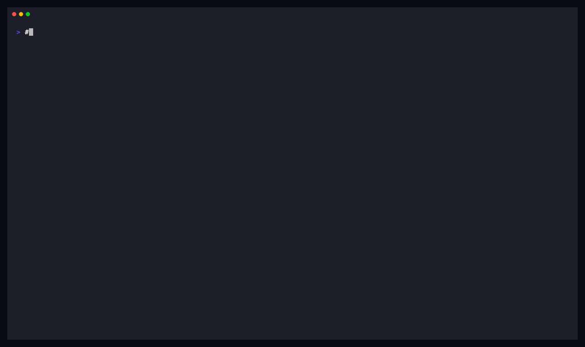

# pi-swival

A Pi package that integrates [Swival](https://github.com/Swival/swival) — a coding agent with a built-in reviewer loop, OS-enforced sandboxing, format-preserving secret encryption, and outbound request filtering — into Pi as a delegation target.



The package bundles:

- `swival-subagent` extension — dispatches tasks to a swival subprocess with reviewer loops, sandboxes, and structured reporting. Mirrors the shape of pi's example subagent extension but swaps the spawn target to swival.
- `swival` skill — drives swival from any Pi agent via the extension, with reference material on AgentFS sandboxing and native provider setup.
- `auditing-with-swival` skill — one native audit on an isolated committed snapshot, with preserved state, reports, and patch proposals.
- `swival-worker-briefs` skill — task brief structure and evidence standards for `self-review-worker` dispatches.
- `swival-audit` prompt template — slash-command-style invocation that walks an interactive operator through the audit pipeline.
- Five swival agents — `swival`, `self-review-worker`, `test-runner`, `sandboxed-explorer`, and `a2a-coordinator`.

## Install

```bash
pi install https://github.com/sheurich/pi-swival
```

Or pin a tag:

```bash
pi install git:github.com/sheurich/pi-swival@v1.0.0
```

Or install from a local checkout:

```bash
pi install /path/to/pi-swival
```

The package registers `extensions/`, `skills/`, and `prompts/` automatically per its `package.json` `pi` manifest. The five bundled swival agents under `agents/` are discovered automatically by the extension at runtime — no symlinks or manual copies needed.

To override a bundled agent or add your own, place `.md` files in `~/.pi/agent/swival-agents/` (user scope) or `.pi/swival-agents/` in a project root (project scope). Discovery priority: project > user > bundled.

## Prerequisites

This package shells out to the `swival` CLI. Install it first:

```bash
uv tool install swival
# or: pipx install swival
```

Swival routes models through `~/.config/swival/config.toml`. Its `bedrock` and `vertexai` providers reach AWS and Google Cloud natively, with no extra process to run. See `skills/swival/references/setup.md` for the full setup walkthrough.

## What's bundled

### Extension: `swival-subagent`

A Pi tool that dispatches single, parallel, or chained tasks, or one structured native audit. Ordinary delegation preserves Swival's raw `--report` outcome and uses the final reviewer exit for acceptance; native audit requires separate state and coverage evidence.

Key features beyond pi's example subagent extension:

- Reviewer loop (`selfReview` or test-as-contract `reviewer`) that retries until the reviewer accepts.
- Kernel & overlay sandboxing (`sandbox: agentfs` SQLite overlay; `sandbox: nono` Landlock/Seatbelt isolation).
- Network policy (`network: provider-only`, `network: none`).
- Format-preserving secret encryption (`encryptSecrets`).
- LLM request auditing (`extraArgs: ["--llm-filter", "..."]`).
- Standard input task delivery (protects prompts from `ps aux` and bypasses `ARG_MAX` when `sandbox: builtin` is configured).
- Operational telemetry (prompt cache token savings, security policy blocks, and storm breaker suppressions).
- Async / background runs with cross-session `status` / `resume` / `interrupt`.

See `skills/swival/SKILL.md` for dispatch examples and `extensions/index.ts` for the full schema.

### Skills

| Skill | Use |
|-------|-----|
| `swival` | Drive swival from any Pi agent — dispatch examples, agent authoring, capabilities reference, troubleshooting. |
| `auditing-with-swival` | Run native audit on committed source with isolated artifacts and explicit coverage checks. |
| `swival-worker-briefs` | Draft precise, verifiable task briefs for `self-review-worker` dispatches. |

### Prompts

| Prompt | Use |
|--------|-----|
| `swival-audit` | `/swival-audit [relative paths or globs]`: confirm routing and audit Pi's configured repository root. |

### Agents

Bundled in `agents/` for the `swival-subagent` tool:

| Agent | Use when |
|-------|----------|
| `swival` | Generic delegate — no system prompt, no review. The implicit default when `agent` is omitted. |
| `self-review-worker` | Implementation, file edits, or artifacts that should pass through `--self-review`; not for review-only tasks. |
| `test-runner` | Task has a runnable test command as acceptance criterion (caller passes `reviewerOverride`). |
| `sandboxed-explorer` | Exploratory changes you want to inspect before applying. |
| `a2a-coordinator` | Coordinate tasks across remote Agent2Agent (A2A) endpoints configured via a2aConfig; requires network: full. |

### Native audit

Start Pi at the target Git root and select a verified, approved profile:

```json
{
  "audit": { "paths": ["src/**/*.py"], "all": true, "workers": 4, "patchMaxTurns": 50 },
  "profileOverride": "<audit-profile>",
  "reasoningEffortOverride": "<audit-effort>"
}
```

Native mode requires Swival 1.0.46, LiteLLM 1.103.3, Python 3.13+, Linux with AgentFS 0.6.4, and nono. Darwin/macOS with AgentFS 0.6.4 is blocked: writable temporary roots expose source files and Git metadata. All other unverified platform/version combinations fail closed. Require a passing real native-layout isolation canary on Linux before use; offline transport tests do not prove OS isolation. There is no sandbox fallback.

Native mode binds the selected profile, effective client provider/model/endpoint, supported cloud selectors, and safe requested execution options across preparation and execution. Route drift fails before Session construction. A native-only transport guard checks primary, auxiliary, and retry calls and blocks model discovery/replacement and Hugging Face text-generation fallback. ChatGPT binds its released environment/default endpoint and rejects conflicting configured bases. Vertex supports only models selected by the released GEMINI handler and rejects unverified dispatch before Session and transport. It rejects ambient endpoint overrides without an explicit configured base. Completion evidence must match the original binding. Credentials and custom user-agent metadata remain runtime-only; the binding proves neither credential ownership nor billing provenance. A profile does not authorize disclosure. Unrepresentable routing fails closed; see the native skill for supported routes.

Native mode uses an independent committed snapshot outside the source checkout and Git metadata. Staged, unstaged, and untracked content is excluded. A tracked `swival.toml` remains auditable from HEAD, while an inert snapshot working copy prevents project runtime settings from executing. After verified process-group shutdown, it preserves bounded native state, reports, and patches before removing owned temporary resources. If preservation fails, it retains the remaining snapshot for diagnosis. Unverified shutdown leaves mutable resources untouched.

Native `async` requires the originating Pi process to stay connected. Pi disconnect cancels the native audit. Terminal results survive restart; without live ownership or valid terminal evidence, disk-only native state is unknown. The wrapper writes a failure fallback to `spawn-error.txt` if completion-marker persistence fails, even after Pi disconnects. The extension never signals or probes a PID recovered from disk.

Native mode validates the startup-selected Git executable before source discovery and pins its canonical path for local and upstream calls. Repository-owned executable paths and relative `PATH` entries are refused. External installation symlinks are allowed after validation.

Native audit may edit its snapshot and generate patches; it is not write-free. No patches apply automatically. Commands and autonomous subagents are disabled, and network remains provider-only. The verifier cannot execute project commands or PoCs; its findings are native verifier judgment, not independently reproduced exploit proof.

Native auxiliary calls and traces omit secret shielding and request filtering upstream. Protected or unknown configurations fail before native launch. Do not turn off controls or fall back to unrestricted network. Requested effort is not guaranteed for every native phase. See the `auditing-with-swival` skill for routing, scope limits, artifacts, and validation.

Compatibility tightening: command-name allowlists, including `git`, are write-capable. Same-cwd parallel dispatch requires both `files=none` and `commands=none`, or verified fresh AgentFS overlays. The retired custom audit orchestration has no aliases; generic plain-language reviews remain available.

Ordinary delegation adds one fixed plain-text heading to task delivery. Leading slash/bang text stays a prompt even with ambient `oneshot_commands=true`; task metadata remains unchanged. Use the explicit `audit` API for native execution. This blocks unintended command-script dispatch; it does not prevent model prompt injection.

## Layout

```text
pi-swival/
├── package.json                # Pi package manifest (pi.extensions, pi.skills, pi.prompts)
├── README.md
├── LICENSE
├── extensions/
│   ├── index.ts                # swival-subagent tool implementation
│   ├── agents.ts               # agent discovery from ~/.pi/agent/swival-agents/
│   └── native-audit.ts         # validation, committed snapshot, native evidence
├── agents/                     # five bundled swival agents (auto-discovered)
├── skills/
│   ├── swival/                 # SKILL.md, references/{agentfs,setup}.md
│   ├── auditing-with-swival/    # native audit workflow
│   └── swival-worker-briefs/   # SKILL.md
├── prompts/
│   └── swival-audit.md         # slash-command-style audit walkthrough
├── scripts/                    # durable runners, Python native bridge, smoke helpers
└── tests/                      # offline unit, dispatch, and native entry-point tests
```

## Running the tests

The harness covers parsing, dispatch, report acceptance, traces, snapshots, artifacts, cancellation, and documentation. Native tests execute released finding, verification, patch, and report phases with stubbed LLM responses and denied sockets and DNS. Lifecycle tests use local transport stubs. No live provider calls are part of the suite.

```bash
./tests/setup.sh      # first time only; run directly, not through npm
npm test
```

Require Node 22.19+ or Node 24, Pi 1.0.4, uv, and an installed Python 3.13. `./tests/setup.sh` installs local Vitest, TypeScript 5.9.3, and Node types 24.10.1 with `--ignore-scripts`, links the selected Pi peers, and syncs hash-locked Swival 1.0.46 into ignored `tests/.venv` using wheels only. It preserves npm configuration and global installations. Run it directly because npm exports script-approval policy to lifecycle children, which prevents the nested npm install. `npm test` and `npm run typecheck` never install dependencies. Native tests never silently skip missing dependencies.

From the package root:

```bash
npm test           # runs the already-installed local Vitest binary
npm run typecheck  # checks extension types against the selected Pi peers
npm run smoke      # offline Pi resource-loader check; no model or credentials
npm run ci         # typecheck + smoke + agentfs canary + vitest
```

The smoke test creates an isolated working directory and agent directory, uses in-memory settings, and loads only this package through `DefaultResourceLoader`. It checks the extension and `swival-subagent` tool, bundled skills and prompt, and agent frontmatter without starting a session or reading stdin.

GitHub Actions runs these checks on Node 22.19.0 and Node 24 with Pi 1.0.4 and pinned Swival 1.0.46. Its required Linux AgentFS job checks native-layout write exceptions and negative source/Git-metadata writes without a provider. The Darwin canary reports native isolation as `BLOCKED`, even when ordinary overlay checks pass. Offline tests do not establish OS isolation or live native provider behavior; live probes require explicit approval, a synthetic repository, and all sandbox prerequisites.

The golden fixtures under `tests/fixtures/` are the source of truth for the swival report schema this package depends on. Schema drift breaks the snapshots, not live runs.

## End-to-end demo

Two recordings under [`demo/`](demo/):

- `demo-quick.gif` (~70s) shows a failing pytest run, a delegated repair via `self-review-worker`, reviewer acceptance, and the same tests passing. This is the headline demo embedded above.
- `demo-reviewer.gif` (~75s) shows `self-review-worker` creating and testing two Python files before Swival's reviewer accepts the result.

Regenerate with `make -C demo`. The recording harness uses a disposable checkout and home, disables ambient Pi resources, and refuses to run unless the installed Pi matches npm's latest release. See [`demo/README.md`](demo/README.md) for requirements and environment variables.

For a longer step-by-step tour covering AgentFS sandboxing and the `/swival-audit` prompt template, see [`examples/demo.md`](examples/demo.md).

## Tradeoffs vs pi's example subagent extension

Pi does not ship a subagent tool by default. The closest reference points are the [example subagent extension](https://github.com/earendil-works/pi/tree/main/packages/coding-agent/examples/extensions/subagent) under `examples/extensions/subagent/` in the pi-coding-agent repo, and third-party packages such as [`pi-subagents`](https://github.com/nicobailon/pi-subagents). The table below compares against the example extension; the third-party packages are similar in shape.

| Feature                   | example `subagent`    | `swival-subagent`     |
|---------------------------|-----------------------|-----------------------|
| Live tool streaming       | yes (`--mode json`)   | no; normal traces arrive at finalization |
| Reviewer loop             | no                    | yes                   |
| Test-as-contract          | no                    | yes                   |
| Sandboxing                | no                    | yes (AgentFS + nono)  |
| Network isolation         | no                    | yes (provider-only, none) |
| Secret encryption         | no                    | yes                   |
| Parallel execution        | yes                   | yes                   |
| Chain mode (`{previous}`) | yes                   | yes                   |
| Async / background runs   | no                    | yes (single-mode only) |

Use the example subagent (or a third-party equivalent) when fine-grained tool-call visibility matters more than correctness checks. Use `swival-subagent` when correctness or sandboxing matters more than display fidelity. The two coexist — install both and pick per task.

## Known limitations

- Swival's normal one-shot traces arrive at finalization, not as live tool events. The watcher preserves tool/session identities and drains pending reads before artifact persistence.
- Swival receives the task on command-line arguments unless the agent explicitly sets `sandbox: builtin`, which pipes it over standard input (keeping it out of `ps aux` and clear of `ARG_MAX`). Project-scope agents cannot use standard input delivery because they are upgraded to `agentfs`. The default is conservative because ambient configuration (`~/.config/swival/config.toml`, `swival.toml`) can enable a re-executing sandbox (AgentFS or nono).
- The agent system prompt body is always passed as `--system-prompt` command-line arguments. Large bodies can hit platform `ARG_MAX` even under `sandbox: builtin`; split long guidance into a skills directory passed via `skillsDir` (or `skillsDirOverride` at dispatch) instead.
- Parallel tasks share the host working tree (no git worktree isolation). Tasks that mutate overlapping files must be dispatched serially or run with per-task `cwd` pointing at pre-created worktrees.
- `async: true` is single-mode only. Parallel and chain modes always run synchronously.
- Artifact directories under `~/.pi/agent/swival-artifacts/` are eligible for pruning after 7 days. Untrusted metadata prevents pruning; identifiable native directories also require metadata and valid shutdown evidence. Unknown or unverified native runs remain retained. Back up reports you need longer.
- Swival's interactive `/goal` REPL command is not available here — the extension always invokes swival non-interactively.

## License

[MIT](LICENSE)
